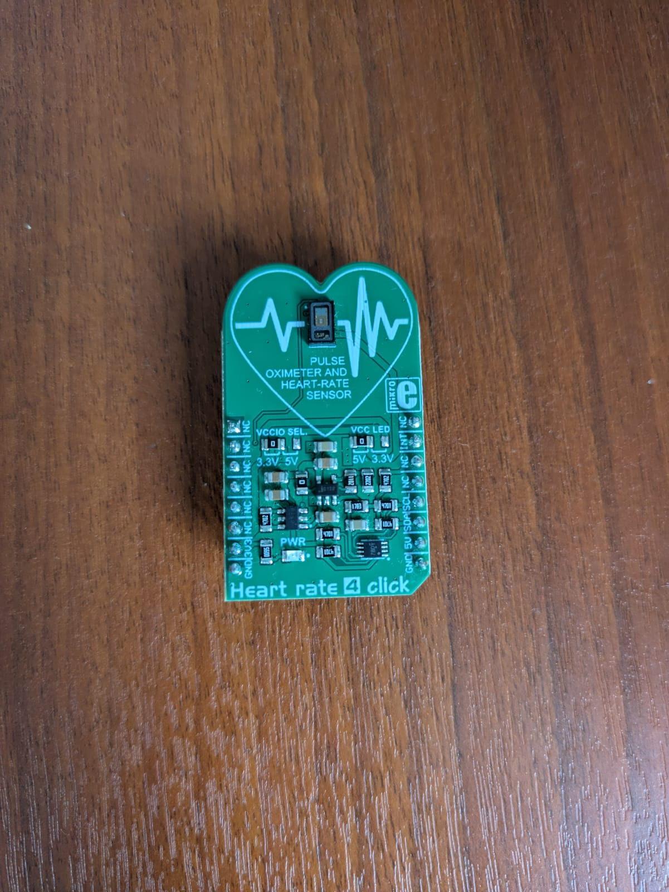
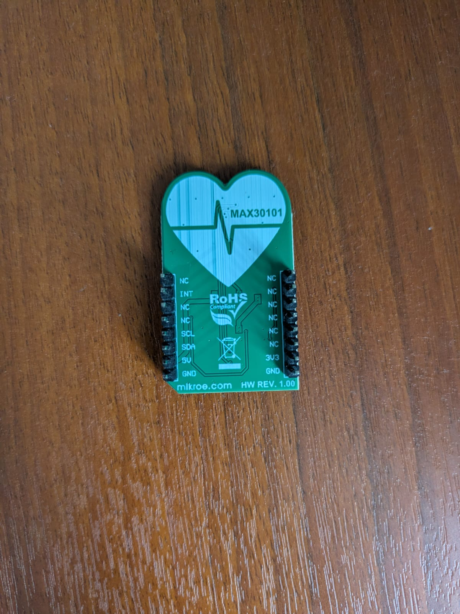

## Propuesta ##

### Objetivo ###
Réplica y miniaturización del módulo **Heart rate 4 click** de MikroElektronika (sensor óptico PPG MAX30101) para integrarlo en un reloj. Se busca reducir las dimensiones de la placa conservando la medición de frecuencia cardíaca y SpO2 por I2C, y eliminando lo propio del formato mikroBUS que no se necesite en el reloj (conector, selección de nivel de tensión, etc.).

### Origen ###
* Producto: https://www.mikroe.com/heart-rate-4-click#/263-clickid-yes
* Circuito esquemático de referencia: [heart-rate-4-click-schematic-v100.pdf](heart-rate-4-click-schematic-v100.pdf)
* Hoja de datos del sensor: [MAX30101.pdf](../../info/MAX30101.pdf)
* Hoja de datos del regulador (SPX3819, alimentación del LED): [1016_SPX3819.pdf](../../info/1016_SPX3819.pdf)

### Circuito de referencia ###
El módulo original se compone de:
* U1 MAX30101 (sensor PPG, I2C, alimentado a 1.8 V con LEDs a VCC-LED).
* U2 SPX3819M5 (regulador ajustable para el LED).
* U3 PCA9306 (adaptador de nivel I2C) y U4 SN74LVC1T45 (adaptador de nivel de la línea INT).
* Jumpers J1A (selección de VCCIO 3.3 V / 5 V) y J2A (selección de VLED), pullups I2C y capacitores de desacople.

### Imágenes del módulo original ###
Frente:

Dorso:

